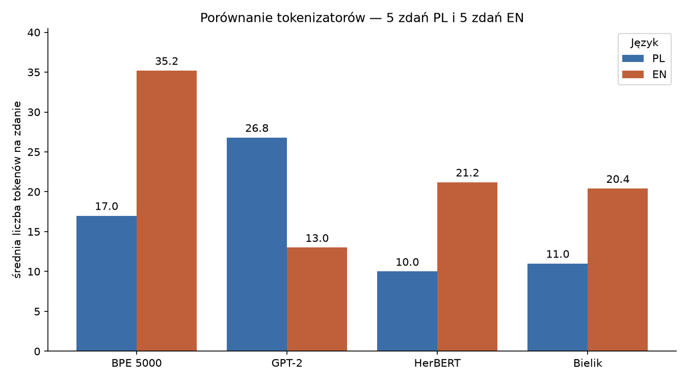

# Część H

Korpus: „Lalka”, t. I. Znakowy BPE. Liczenie bez tokenów specjalnych.

## Trzy rozmiary słownika

| Docelowy słownik | Uzyskany słownik | Tokeny w korpusie | Średnia PL | Średnia EN |
| --- | --- | --- | --- | --- |
| 1000 | 1000 | 296336 | 23.80 | 41.00 |
| 5000 | 5000 | 202670 | 17.00 | 35.20 |
| 30000 | 30000 | 141267 | 12.60 | 31.80 |

## Podział słów

| Słowo | 1000 | 5000 | 30000 |
| --- | --- | --- | --- |
| nieprzetłumaczalny | ["nie", "p", "rze", "t", "łu", "ma", "cz", "al", "ny"] | ["nie", "p", "rze", "t", "łu", "ma", "cz", "al", "ny"] | ["nie", "prze", "tłu", "ma", "cz", "alny"] |
| hiperparametryzacja | ["h", "i", "p", "er", "p", "a", "ra", "m", "et", "ry", "za", "cj", "a"] | ["hi", "per", "p", "ara", "m", "et", "ry", "za", "cja"] | ["hi", "per", "para", "met", "ry", "za", "cja"] |
| kotkowi | ["ko", "t", "k", "owi"] | ["ko", "tk", "owi"] | ["ko", "tk", "owi"] |
| Wokulskiego | ["W", "okul", "skiego"] | ["W", "okul", "skiego"] | ["W", "okul", "skiego"] |

## Zdania testowe

| ID | Zdanie |
| --- | --- |
| PL1 | Wokulski rozmawiał z Izabelą o przyszłości sklepu. |
| PL2 | Rano kupiec otworzył sklep i przywitał pierwszych klientów. |
| PL3 | Na dworcu czekał pociąg do Warszawy. |
| PL4 | Nieprzetłumaczalny żart utrudnił rozmowę podczas spotkania. |
| PL5 | Hiperparametryzacja modelu wymaga dokładnych eksperymentów. |
| EN1 | Wokulski talked with Izabela about the future of the shop. |
| EN2 | In the morning, the merchant opened the shop and greeted the first customers. |
| EN3 | A train to Warsaw was waiting at the station. |
| EN4 | An untranslatable joke made the conversation difficult during the meeting. |
| EN5 | Hyperparameter tuning of the model requires careful experiments. |

## Liczba tokenów

| ID | BPE 5000 | GPT-2 | HerBERT | Bielik |
| --- | --- | --- | --- | --- |
| PL1 | 12 | 29 | 10 | 12 |
| PL2 | 14 | 30 | 11 | 11 |
| PL3 | 11 | 18 | 7 | 8 |
| PL4 | 23 | 32 | 11 | 12 |
| PL5 | 25 | 25 | 11 | 12 |
| EN1 | 31 | 16 | 17 | 17 |
| EN2 | 42 | 15 | 27 | 24 |
| EN3 | 23 | 10 | 15 | 15 |
| EN4 | 46 | 13 | 25 | 25 |
| EN5 | 34 | 11 | 22 | 21 |

## Średnie

| Tokenizer | PL | EN | PL/EN |
| --- | --- | --- | --- |
| BPE 5000 | 17.00 | 35.20 | 0.483 |
| GPT-2 | 26.80 | 13.00 | 2.062 |
| HerBERT | 10.00 | 21.20 | 0.472 |
| Bielik | 11.00 | 20.40 | 0.539 |

